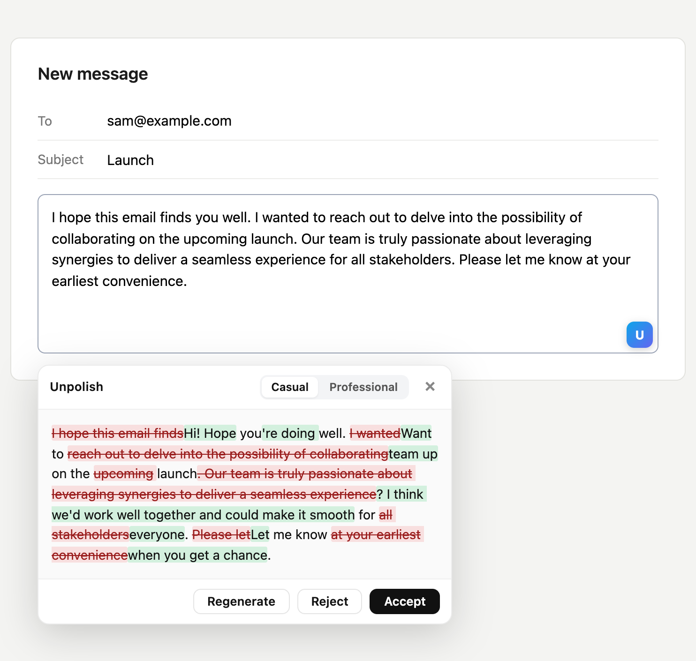
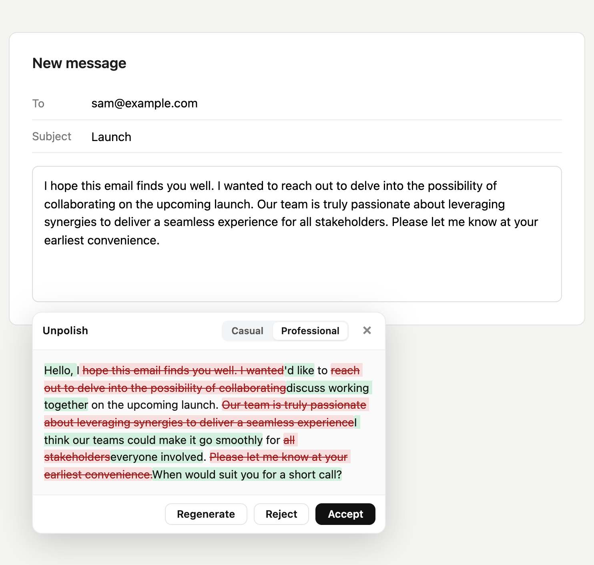
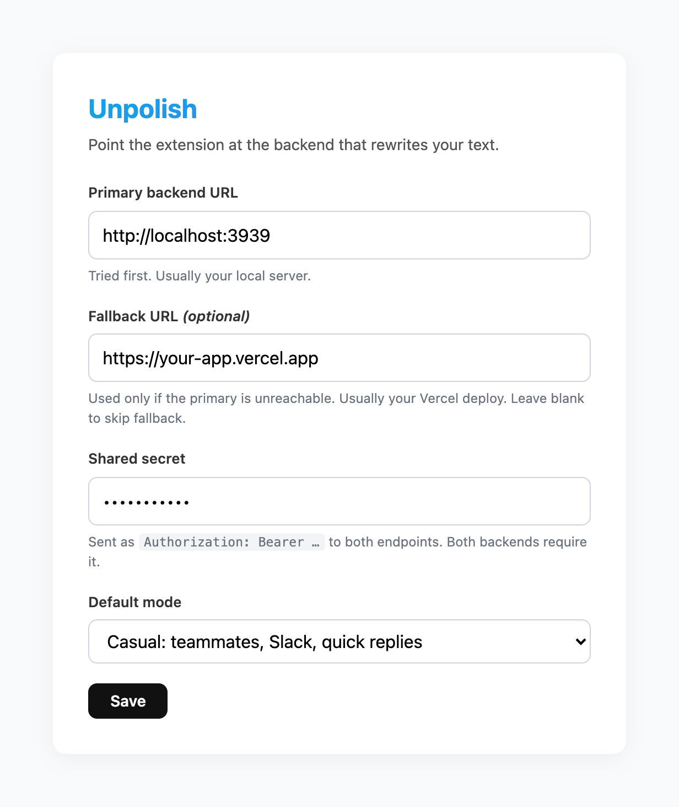

# Unpolish

A Chrome extension that rewrites the text you're typing, in a casual or professional tone, right inside the field on any site. It shows a word diff of the change, and you accept or reject it.

The idea comes from Ben Horwitz's Sinceerly extension; this is my own implementation.

<p>
  
  
</p>
<p>
  
</p>
<sub>Shown with a mock backend and sample text.</sub>

## How it works

- A small floating U button appears on the field you're focused on.
- Site adapters handle Gmail, LinkedIn and Slack. A generic fallback covers any other textarea, text input or contenteditable element.
- Structured fields like dates, phone numbers and IBANs are skipped.
- When you click the button, the background worker sends your text to the backend. Nothing is sent before that.
- A shadow-DOM preview panel shows a word diff, a Casual/Professional toggle, and Accept, Regenerate and Reject buttons.
- Accept writes the text back in a way that keeps rich-text editors working.

## Backends

The same code runs in two places:

- **Local:** a Hono server on `127.0.0.1:3939` that calls Claude through the Claude Agent SDK, with all tools disabled.
- **Remote:** a Vercel function that calls the Anthropic API.

The extension tries the local backend first with a 3 second timeout. If that fails, it tries the remote one with a 30 second timeout. The default model is `claude-haiku-4-5-20251001`. Set `MODEL` to change it.

## Security

- Both backends require a shared secret and reject requests without it.
- The local server rejects requests from web pages by checking the `Origin` header. Only `chrome-extension://` origins get through.
- The model gets no tools.
- Input is capped at 5,000 characters.
- If you self-host, set a monthly spend limit on your Anthropic API key.

## Setup

You need Node 20 or newer and Chrome (or another Chromium browser). The local backend also needs the [Claude Code CLI](https://docs.claude.com/en/docs/claude-code/getting-started), signed in. The Vercel deploy needs an Anthropic API key from [console.anthropic.com](https://console.anthropic.com).

Pick a secret first:

```bash
openssl rand -hex 32
```

### Build the extension

```bash
cd extension
npm install
npm run build
```

In Chrome, open `chrome://extensions`, turn on Developer mode, click Load unpacked and select `extension/dist`.

### Run the local backend

```bash
cd backend
npm install
SHARED_SECRET=<your secret> npm start
```

Quick check. This should return 401, because the secret is missing:

```bash
curl -i -X POST http://127.0.0.1:3939/api/humanify \
  -H "Content-Type: application/json" \
  -d '{"text":"hello","mode":"casual"}'
```

### Deploy the backend to Vercel

```bash
cd backend
npm i -g vercel        # if you don't have it
vercel link            # one-time
vercel env add ANTHROPIC_API_KEY production
vercel env add SHARED_SECRET production
vercel deploy --prod   # or: npm run deploy
```

The function is served at `/api/humanify` on your Vercel URL.

### Configure the extension

Right-click the extension icon and open Options. Paste your backend URL (`http://localhost:3939` for local), a fallback URL (your Vercel URL), and the shared secret. The same secret is sent to both backends. Save.

## Adding a site adapter

Drop an adapter in `extension/src/content/adapters/` and register it in `adapter-registry.ts`.

## Development

```bash
cd backend && npm run dev        # hot reload
cd extension && npm run dev      # then reload the extension in chrome://extensions
cd backend && npm run typecheck
cd extension && npm run typecheck
```

## Stack

TypeScript, Chrome MV3, Vite with @crxjs, diff, Hono, the Claude Agent SDK and the Anthropic SDK.

## License

MIT
